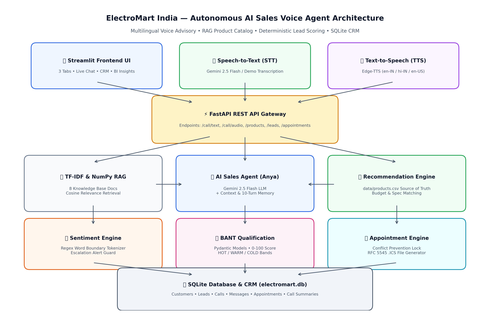

# ElectroMart India — Autonomous AI Sales Voice Agent

[](https://python.org)
[](https://fastapi.tiangolo.com)
[](https://streamlit.io)
[](https://ai.google.dev/)
[](https://github.com/rany2/edge-tts)
[](https://sqlite.org)
[](LICENSE)

An autonomous, multilingual B2B/B2C Electronics Retail Sales Voice Agent built for a senior AI engineering hiring challenge. The agent speaks with inbound shoppers, understands technical requirements, deterministically recommends products from a 25-item catalog using RAG, qualifies leads (0–100 BANT score + HOT/WARM/COLD bands), schedules showroom appointments, prevents double-booking, and synchronizes call summaries with an integrated SQLite CRM.

---

## 🏛️ System Architecture



```
[Customer Browser / Microphone]
         │ (Audio / Text)
         ▼
[Streamlit SaaS UI / FastAPI Gateway]
         │
    ┌────┴───────────────────────────┐
    ▼                                ▼
[Gemini STT]                 [TF-IDF & NumPy RAG Engine]
(gemini-2.5-flash / Demo)    (8 Knowledge Base Docs + Cosine Sim)
    │                                │
    └──────────────┬─────────────────┘
                   ▼
       [Anya: AI Sales Agent] ──▶ [Deterministic Product Recommender]
       (Gemini 2.5 Flash / Demo)   (data/products.csv Source of Truth)
                   │          ──▶ [BANT Lead Scoring (0-100)]
                   │          ──▶ [Regex Sentiment Engine (-1 to 1)]
                   │
    ┌──────────────┴─────────────────┐
    ▼                                ▼
[Edge-TTS Neural Audio]      [Transactional Booking & CRM]
(en-IN / hi-IN / en-US)      (SQLite electromart.db + .ICS file)
```

---

## 📊 Feature Status Table

| Feature | Category | Implementation Details |
| :--- | :--- | :--- |
| **Multilingual Voice & Text Chat** | **Working** | Streamlit chat UI + Edge-TTS neural speech in Indian English (`en-IN-NeerjaNeural`), Telugu (`te-IN-ShrutiNeural`), and Kannada (`kn-IN-SapnaNeural`). |
| **STT Voice Transcription** | **Working** (Gemini) / **Demo Mode** | Uses `gemini-2.5-flash` via `google-genai` SDK; graceful offline text input fallback in Demo Mode. |
| **Catalog Recommendation Engine**| **Working** | Budget & spec filtering over `data/products.csv`. Does not hallucinate non-existent products. |
| **Company RAG Retrieval** | **Working** | Cosine similarity over 8 `knowledge_base/*.txt` documents using TF-IDF and NumPy. |
| **BANT Lead Qualification** | **Working** | Objective 0–100 scoring (Requirement: 20, Budget: 20, Timeline: 25, Contact: 15, Intent: 20) with HOT/WARM/COLD status. |
| **Live Sentiment & Trajectory** | **Working** | Turn-by-turn sentiment scoring (-1.0 to +1.0) with regex word boundaries and live UI line chart. |
| **Showroom Appointment Booking** | **Working** | Operating hours check (10 AM to 8:30 PM), duplicate booking lock, and RFC 5545 `.ics` invite generation. |
| **SQLite CRM & Webhook Sync** | **Working** | Relational schema storing Customers, Leads, Calls, Messages, Appointments, and Call Summaries. |
| **Zero-Key Demo Mode** | **Demo Mode** | Complete sales interaction runs offline out-of-the-box with pre-seeded datasets and zero external API keys. |
| **Telephony Integration** | **Future enhancement** | SIP trunking and WebRTC gateway architecture detailed in `reports/project_report.md`. |
| **100,000 Concurrent Calls** | **Future enhancement** | Enterprise scalability roadmap (Kubernetes, Redis, Qdrant, PgBouncer) documented in report. |

---

## 🚀 Quickstart & Setup

### 1. Prerequisites
- Python 3.10+ (Tested on Python 3.11)
- Git

### 2. Installation
```powershell
# Clone or navigate to the repository
cd "f:\AI VOICE AGENT"

# Create and activate virtual environment (optional)
python -m venv venv
.\venv\Scripts\activate

# Install required dependencies
pip install -r requirements.txt
```

### 3. Environment Configuration
Create a `.env` file from the provided example:
```powershell
cp .env.example .env
```
- **To run in Gemini AI Mode**: Add your Gemini key to `.env`:
  ```ini
  GEMINI_API_KEY=your_gemini_api_key_here
  ```
- **To run in Demo Mode (Zero Key Required)**: Leave `GEMINI_API_KEY` empty. The application runs offline with full sales intelligence.

---

### 4. Running the Application

Open two terminal windows:

#### Terminal 1 — Start FastAPI Backend (Port 8000)
```powershell
python -m uvicorn backend.main:app --port 8000 --reload
```
API Documentation (Swagger UI): [http://localhost:8000/docs](http://localhost:8000/docs)

#### Terminal 2 — Launch Streamlit Dashboard (Port 8501)
```powershell
python -m streamlit run app.py
```
Streamlit Application: [http://localhost:8501](http://localhost:8501)

---

## 🧪 Automated Testing
Run the automated test suite verifying dataset consistency, recommendations, lead scoring, appointment locks, sentiment, and RAG retrieval:
```powershell
python -m pytest tests/ -v
```
*Result: 13 passed in 2.65s.*

---

## 🎭 Live Demo Script (Step-by-Step)
Follow the complete script in [`demo_script.md`](file:///f:/AI%20VOICE%20AGENT/demo_script.md):
1. **Inquiry:** *"I am looking for a laptop under ₹70,000."*
2. **Use Case:** *"Programming and multitasking."*
3. **Specifications:** *"At least 16 GB RAM and a good processor."*
   - Agent recommends: **CodeMaster Pro 15** (₹64,999), **ZenithBook Air 15** (₹48,999), and **DevForge Extreme 16** (₹79,999).
4. **Comparison:** *"Which one is best for me?"*
   - Agent explains why CodeMaster Pro 15 suits programming within ₹70,000.
5. **Store Booking:** *"Can I visit your store tomorrow? 4 PM. My name is Priya Patel, email is priya.patel@example.com."*
   - Agent verifies showroom hours, prevents conflicts, books the slot, and outputs a downloadable `.ics` calendar invite.
   - Lead Score jumps to **HOT (95/100)**.
6. **Summary & Insights:** Click **"⏹️ End Call & Generate Summary"** to inspect the structured executive summary card and view records in Tabs 2 & 3.

---

## 🛠️ Live-Coding Cheat Sheet (For Interview Demonstration)

| What to Modify Live | File to Open | Variable or Section |
| :--- | :--- | :--- |
| **Gemini Chat Model** | [`backend/config.py`](file:///f:/AI%20VOICE%20AGENT/backend/config.py) | `GEMINI_MODEL_CHAT = "gemini-2.5-flash"` |
| **TTS Neural Voice** | [`backend/config.py`](file:///f:/AI%20VOICE%20AGENT/backend/config.py) | `TTS_VOICES["en"] = "en-IN-NeerjaNeural"` |
| **Lead Scoring Weights**| [`backend/lead_qualification.py`](file:///f:/AI%20VOICE%20AGENT/backend/lead_qualification.py) | `LEAD_SCORING_WEIGHTS = {...}` |
| **Recommendation Filter**| [`backend/product_recommendation.py`](file:///f:/AI%20VOICE%20AGENT/backend/product_recommendation.py) | `recommend_products(...)` scoring rules |
| **Store Business Hours**| [`backend/appointment.py`](file:///f:/AI%20VOICE%20AGENT/backend/appointment.py) | `BUSINESS_START_HOUR = 10`, `BUSINESS_END_HOUR = 20` |
| **System Personality** | [`backend/ai_agent.py`](file:///f:/AI%20VOICE%20AGENT/backend/ai_agent.py) | `ELECTROMART_SYSTEM_PROMPT` |

---

## 📂 Project Structure
```
AI-Sales-Voice-Agent/
├── app.py                      # Streamlit UI (3 Tabs: Live Call, Products & CRM, BI Insights)
├── requirements.txt            # Pinned dependencies
├── .env                        # Environment variables (GEMINI_API_KEY)
├── .env.example
├── .gitignore
├── .streamlit/config.toml      # Polished light theme styling
├── demo_script.md              # Exact English, Telugu, and Kannada scenario transcripts
├── README.md                   # Complete documentation
│
├── backend/
│   ├── main.py                 # FastAPI endpoints & CORS
│   ├── config.py               # Central model names, voices & business parameters
│   ├── ai_agent.py             # Agent orchestrator & offline demo mode
│   ├── product_recommendation.py# Deterministic recommendation engine
│   ├── rag.py                  # TF-IDF & NumPy cosine similarity retrieval
│   ├── lead_qualification.py   # BANT 0-100 scoring & Pydantic models
│   ├── sentiment.py            # Word-boundary sentiment engine (-1 to 1)
│   ├── appointment.py          # Operating hours check, conflict lock & .ics generator
│   ├── speech_to_text.py       # Gemini STT via google-genai SDK
│   ├── text_to_speech.py       # Edge-TTS multi-voice synthesis
│   └── summarizer.py           # Structured executive call summary generator
│
├── database/
│   ├── db.py                   # SQLAlchemy engine, session factory & CSV auto-seeder
│   ├── models.py               # Customer, Lead, Call, Message, Appointment, CallSummary
│   └── electromart.db          # SQLite persistent database
│
├── data/
│   ├── products.csv            # 25 products (Laptops, Phones, Tablets, Accessories)
│   ├── customers.csv           # 20 customer records
│   ├── sample_leads.csv        # 15 qualified leads
│   ├── sample_conversations.json # 10 multi-turn transcripts
│   ├── appointments.csv        # 10 scheduled appointments
│   ├── offers.csv              # 10 promotional offers
│   ├── faqs.json               # 25 verified retail FAQs
│   └── data_dictionary.md      # Data dictionary for all datasets
│
├── knowledge_base/
│   ├── company_profile.txt
│   ├── product_catalog.txt
│   ├── pricing_and_offers.txt
│   ├── warranty_and_return_policy.txt
│   ├── delivery_and_payment.txt
│   ├── product_recommendation_guide.txt
│   ├── sales_faq.txt
│   └── comparison_guide.txt
│
├── reports/
│   ├── project_report.md       # One-page executive project report
│   └── interview_preparation.md# 60-second file pitch & 20 technical interview Q&As
│
├── architecture/
│   ├── generate_diagram.py     # Matplotlib architecture generator script
│   └── system_architecture.png # Generated architecture visualization
│
└── tests/
    └── test_core.py            # 13 automated Pytest test cases
```
