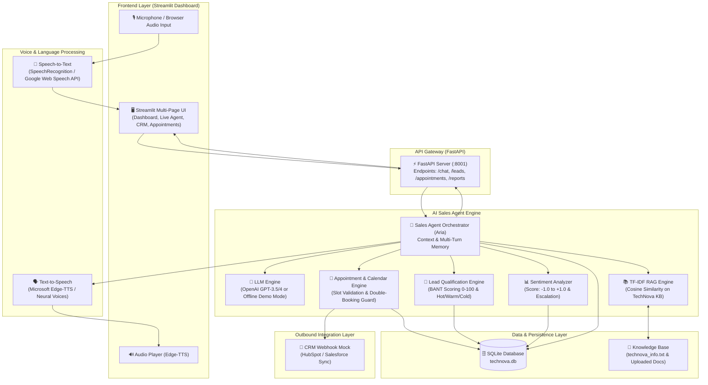

# System Architecture — Autonomous AI Sales Voice Agent

## High-Level System Architecture

---

## 15-Step End-to-End Processing Workflow

1. **User Input:** Prospect speaks into the browser microphone or types in chat.
2. **Audio Capture:** Streamlit captures `.wav` audio binary from `st.audio_input`.
3. **STT Transcription:** `backend/technova_stt.py` converts speech to text via SpeechRecognition.
4. **API Transmission:** Streamlit sends text payload to FastAPI `/chat` or calls `chat()` directly.
5. **Context Retrieval (RAG):** `backend/technova_rag.py` runs TF-IDF vectorization and retrieves top-3 matching chunks from `knowledge_base/technova_info.txt`.
6. **Sentiment Analysis:** `backend/technova_sentiment.py` evaluates turn sentiment and detects escalation keywords.
7. **Lead Extraction:** `backend/technova_leads.py` extracts entity fields (Name, Email, Phone, Company, Budget, Timeline, Needs).
8. **Lead Qualification:** Computes 0-100 BANT score and classifies lead status (`Hot`, `Warm`, `Cold`).
9. **Agent Reasoning:** LLM (OpenAI API if key present, else intelligent rule-based Demo Mode) generates contextual sales reply.
10. **Appointment Detection:** If the prospect asks to schedule a demo, `backend/technova_appointment.py` checks availability and reserves a slot.
11. **TTS Synthesis:** `backend/technova_tts.py` invokes Edge-TTS to produce high-quality natural MP3 audio.
12. **Database Persistence:** Messages, conversation session, lead profile, and sentiment score are saved to SQLite (`technova.db`).
13. **Audio Playback:** UI renders the agent's text response and plays back synthesized audio.
14. **Live Dashboard Update:** Metrics, sentiment trajectory chart, and lead status update in real time.
15. **Call Summary & CRM Sync:** At call termination, structured summary is generated and CRM webhook mock is triggered.
