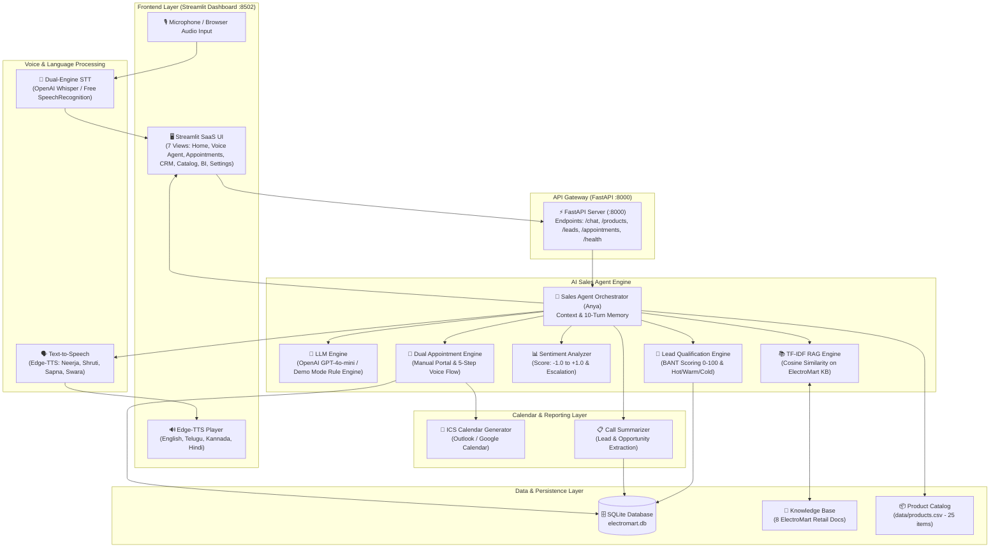

# System Architecture — ElectroMart India Autonomous AI Sales Voice Agent

## High-Level System Architecture

---

## 15-Step End-to-End Processing Workflow

1. **User Input:** Customer speaks into the browser microphone or types in chat (English, Telugu, Kannada, Hindi).
2. **Audio Capture:** Streamlit captures `.wav` audio binary from `st.audio_input`.
3. **STT Transcription:** `backend/speech_to_text.py` converts speech to text via OpenAI Whisper API or Free SpeechRecognition across 4 languages.
4. **API Transmission:** Streamlit transmits user query to FastAPI `/chat` or invokes `execute_sales_turn()`.
5. **Context Retrieval (RAG):** `backend/rag.py` runs TF-IDF vectorization and retrieves top-3 matching chunks from the 8 ElectroMart knowledge base files.
6. **Sentiment Analysis:** `backend/sentiment.py` evaluates turn sentiment (-1.0 to 1.0) and detects escalation flags.
7. **Lead Extraction:** `backend/lead_qualification.py` extracts validated entities (Name, Email, Phone, City, Category, Budget, Timeline).
8. **Lead Qualification:** Computes 0-100 BANT score and classifies lead status (`HOT`, `WARM`, `COLD`).
9. **Agent Reasoning:** LLM (OpenAI GPT-4o-mini if key present, else intelligent Demo Mode) generates contextual electronics consultation reply or directly answers product specs.
10. **Dual Appointment Booking:** Via conversational 5-step flow or dedicated manual booking portal with past-date checks, business hours validation (10 AM - 8:30 PM), duplicate booking lock, and RFC 5545 `.ics` calendar generation.
11. **TTS Synthesis:** `backend/text_to_speech.py` invokes Edge-TTS to produce natural speech in English (`Neerja`), Telugu (`Shruti`), Kannada (`Sapna`), or Hindi (`Swara`).
12. **Database Persistence:** Messages, call sessions, lead attributes, and catalog recommendations are committed to SQLite (`electromart.db`).
13. **Audio Playback:** Streamlit UI displays agent response and autoplays synthesized speech audio.
14. **Live Dashboard Update:** Live intelligence card, BANT score bar, sentiment trajectory chart, and catalog cards update dynamically.
15. **Call Summary & BI Sync:** At call termination, executive call summary is generated and committed to the CRM dashboard.
