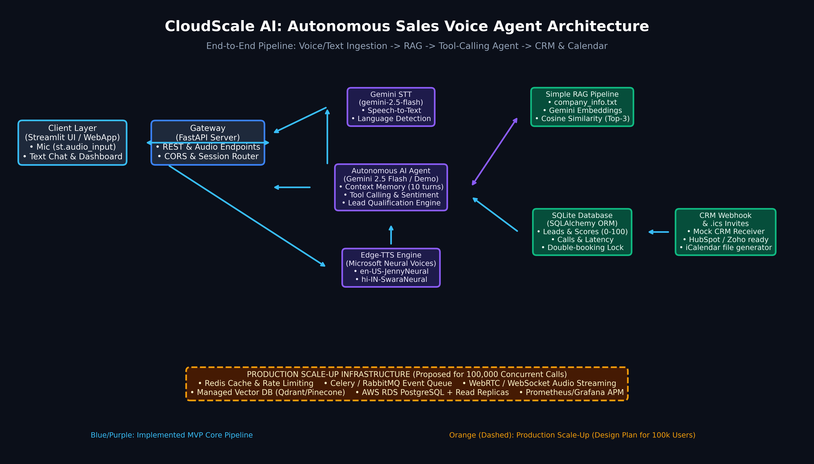

# Project Report: Autonomous AI Sales Voice Agent MVP

## 1. Business Problem & Value
Modern B2B SaaS companies lose up to 60% of inbound sales pipeline due to delayed lead response times, inconsistent qualification criteria, and lack of 24/7 global coverage. This MVP provides an always-on, autonomous AI Sales Voice Agent (**Ava**) for **CloudScale AI**. The agent answers technical questions strictly from the company knowledge base, scores and categorizes leads (HOT/WARM/COLD), detects sentiment, checks real-time calendar availability, books demos without double-booking, and synchronizes data with downstream CRMs.

## 2. Solution & Key Features
- **Voice & Multilingual Speech**: Browser microphone input with Gemini Speech-to-Text and high-fidelity Edge-TTS neural speech in English and Hindi.
- **Strict RAG Pipeline**: In-memory vector chunking and cosine similarity over company offerings, ensuring zero hallucinated pricing.
- **Lead Qualification Engine**: Deterministic 0-100 scoring based on budget, purchase timeline, authority, need, and contact completeness.
- **Transactional Appointment Booking**: Real-time availability checks, double-booking prevention with SQLite transactions, and `.ics` calendar generation.
- **Call Summarization & CRM Webhook**: Structured post-call executive debriefs and mock HubSpot/Zoho webhook dispatch.
- **Zero-Key Demo Mode**: Fully functional offline fallback guaranteeing seamless hiring evaluations without external API keys.

## 3. Tech Stack & Architecture Flow
- **Frontend**: Streamlit 1.32+ (Custom dark theme, reactive session state, metric cards, audio playback).
- **Backend**: FastAPI 0.110+ (Asynchronous REST API, CORS middleware, transactional endpoints).
- **AI & Speech**: Google GenAI SDK (`gemini-2.5-flash`), `text-embedding-004`, Microsoft Edge-TTS (`edge-tts`).
- **Data Persistence**: SQLite 3 via SQLAlchemy ORM (Leads, Calls, Messages, Appointments).

## 4. Scalability Strategy (100,000 Concurrent Calls Design Plan)
*Note: This architecture is a production design plan, not a tested benchmark.*
1. **Stateless API Gateway**: Containerized FastAPI pods running on Kubernetes (EKS/GKE) horizontally autoscaled via KEDA on CPU and request latency.
2. **Real-Time Audio Streaming**: Transition from turn-based HTTP to bidirectional WebSockets / WebRTC to achieve <600ms latency.
3. **Distributed Event Queues**: Offload sentiment analysis, lead CRM synchronization, and call summarization to Celery / RabbitMQ workers.
4. **Enterprise Vector & Data Tier**: Migrate from in-memory RAG to a managed vector store (Qdrant/Pinecone) and migrate SQLite to AWS Aurora PostgreSQL with multi-AZ read replicas.
5. **Multi-Model Cost Routing**: Route routine inquiries to lightweight models (`gemini-2.5-flash`) and complex enterprise negotiations to larger reasoning models.

## 5. Data Security, Privacy & Compliance
- **Zero Raw Data Training**: Telemetry strictly uses inference endpoints under enterprise non-training commitments.
- **PII Masking & Encryption**: SHA-256 tokenization on emails and phones, TLS 1.3 in transit, and AES-256 for persistent database storage.
- **Regulatory Compliance**: Explicit consent banners for call recording adhering to DPDP (India) and GDPR (EU) Right-to-be-Forgotten protocols.

## 6. Deployment & Cost Analysis
- **Containerization**: Standard multi-stage `Dockerfile` (Python 3.11-slim) exposing ports 8000 and 8501.
- **Cost per Call Minute (Assumptions)**:
  * STT (Gemini Audio): ~$0.004 / min
  * LLM Inference (Gemini 2.5 Flash, ~300 tokens/turn): ~$0.002 / min
  * TTS (Edge-TTS / Neural API): ~$0.000 / min (Edge-TTS) or ~$0.008 / min (Commercial)
  * Cloud Compute & DB: ~$0.003 / min
  * **Total Estimated Cost**: **~$0.012 to $0.017 per minute**.
  * *Comparison*: A human SDR costs ~$35-50/hour (~$0.60-$0.85/min). The AI agent delivers a **97% cost reduction** with instant response coverage.

## 7. Roadmap
- Telephony integration via Twilio / Exotel SIP trunking.
- Barge-in full duplex speech interruption.
- Native bi-directional HubSpot and Salesforce CRM OAuth sync.
